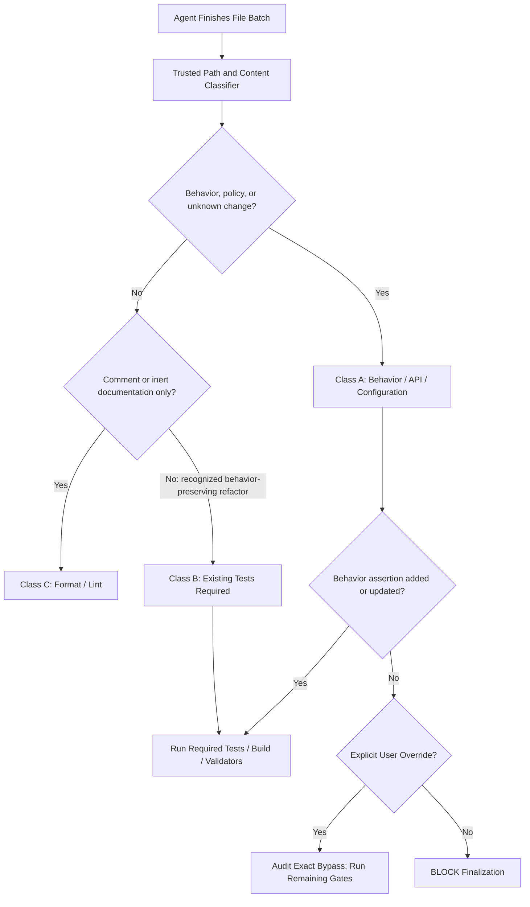

# [ATE-1000] System Architecture Specification: DevCode Harness

```
================================================================================
STANDARD       : ATE-1000 (Automated Technical Engineering Standard Series)
DOCUMENT ID    : ATE-1000-ARCH
REVISION       : 0.3.0-draft
STATUS         : Working Draft (Engineering Specification)
AUTHOR         : DevCode Architecture Group
RELATED DOCS   : [docs/prd.md](prd.md), [docs/codebaseunderstanding.md](codebaseunderstanding.md)
================================================================================
```

---

## 1.0 System Overview & Engineering Philosophy

**DevCode** is an autonomous, developer-centric agentic CLI harness built for disciplined software engineering. 

Rather than boxing developers into forced state-machine ceremonies or making unachievable claims about OS sandboxing, DevCode is built on a **Single Agent Loop with Dynamic Policy Profiles**, **Deterministic Verification Gates**, and **Transparent Security Boundaries**.

```
+------------------------------------------------------------------------------------+
|                               DEVCODE SYSTEM HARNESS                               |
+------------------------------------------------------------------------------------+
|                                                                                    |
|  +-------------------+       +--------------------------------------------------+  |
|  | CLI / TUI UX      |       | UNIFIED AGENT CORE                               |  |
|  | - Diff Inspector  | ----> | - Single continuous agent loop                   |  |
|  | - Profile Switch  |       | - Context Assembler (ATE-1002 Dual-Tier)         |  |
|  | - Manifest Rolls  |       | - Context Compaction & Sliding Window Manager    |  |
|  +-------------------+       +-------------------------+------------------------+  |
|                                                        |                           |
|                                                        v                           |
|  +--------------------------------+         +-----------------------------------+  |
|  | PRAGMATIC RUNTIME BOUNDARIES   |         | INDEPENDENT VERIFICATION GATES    |  |
|  | - FS Allowlist (realpath)      | <-----> | - Rule-Based Path Classifier      |  |
|  | - Step Manifest Rollback       |         | - Test Gate (Class A/B/C)         |  |
|  | - Credential Env Stripping     |         | - Linter / Compiler Gates         |  |
|  | - Process Group Watchdog (PGID)|         | - SAST Orchestrator (Semgrep)     |  |
|  | - Linux bwrap net (opt-in)     |         | - Immutable Audit Log             |  |
|  +--------------------------------+         +-----------------------------------+  |
|                                                                                    |
+------------------------------------------------------------------------------------+
```

### Core Architecture Tenets
1. **Modes as Policy & Permission Profiles, Not Control Flow**: Modes (`plan`, `build`, `debug`, `security`) are lenses that alter prompting emphasis and tool permissions. The execution engine remains a single fluid loop.
2. **The Differentiator is the Gate**: Anyone can generate code; DevCode blocks harness finalization until required checks pass or the user explicitly authorizes an audited override. Edits remain provisional on disk during verification; external Git commands are outside this gate.
3. **No Self-Grading Gates**: The model cannot classify its own edits as "exempt" to bypass testing. File classification is evaluated by deterministic path rules and AST heuristics.
4. **Honest Engineering Boundaries**: No claims of magical "air-tight process isolation" on platforms that do not support it. Boundaries are defined as strict path allowlists, credential stripping, process timeouts, and opt-in Linux namespaces.
5. **Zero Mutation of User State**: Checkpoints rely on **Step Manifests and selective working-tree restores**, preserving pre-step content even in touched files and never modifying the developer's staged index. Concurrent edits cause rollback conflicts rather than silent overwrites.

---

## 2.0 Subsystem Decomposition

```
+---------------------------+------------------------------------------------------------------------+
| Subsystem                 | Architectural Responsibility                                           |
+---------------------------+------------------------------------------------------------------------+
| 1. Profile Controller     | Injects mode-specific system prompts, tool allowlists, and gate rules. |
| 2. Context Engine         | Dual-Tier Graph (JIT ripgrep + threshold-gated AST PageRank).          |
| 3. Step Manifest Engine   | Tracks file mutations (created, modified, deleted) for safe rollback.  |
| 4. Runtime Guard          | Enforces FS allowlists, credential env stripping, and PGID timeouts.   |
| 5. Gatekeeper & Auditing  | Evaluates file classifications, runs linters/tests, and logs overrides.|
| 6. Configuration Loader   | Parses `.devcode.json` project config for build/test/lint commands.   |
+---------------------------+------------------------------------------------------------------------+
```

---

## 3.0 Modes as UX & Permission Profiles

Instead of a forced multi-state transition graph that interrupts developer flow, DevCode implements modes as **behavioral profiles** governing tool permissions and verification rigor:

```
+-------------------+--------------------+----------------------------------+---------------------------------------+
| Mode Profile      | FS Permissions     | Network Access                   | Enforced Verification Gate            |
+-------------------+--------------------+----------------------------------+---------------------------------------+
| `plan`            | Strictly Read-Only | Unrestricted (Env stripped)      | Structured task specification output  |
| `build` (Default) | Scoped Read/Write  | Unrestricted (Env stripped)*     | Typecheck + Linter + Test Gate (TDD)  |
| `debug`           | Scoped Read/Write  | Unrestricted (Env stripped)*     | Minimal Reproducer Test (Red -> Green)|
| `security`        | Read-Only          | Unrestricted (Local DBs cached)  | Secret scan (Gitleaks) + SAST Semgrep |
+-------------------+--------------------+----------------------------------+---------------------------------------+
```
*\*On Linux, network can be strictly unshared via `bwrap --unshare-net` if enabled in `.devcode.json`. On macOS/Windows, socket creation is unrestrained at the OS level; credentials and tokens are stripped from the process environment.*

### 3.1 Profile Definitions
- **`plan` Profile**: Maximizes read-only exploration tools (`Glob`, `Grep`, `FileRead`, `RepoMap`). Write and shell mutation tools are disabled at the tool schema level.
- **`build` Profile**: Unlocks surgical file edits. Automatically triggers the Verification Gate upon completion of any file batch.
- **`debug` Profile**: Focuses prompt attention on hypothesis testing and minimal reproduction scripts before modifying target code.
- **`security` Profile**: Orchestrates local security scanners, producing remediation diffs without allowing arbitrary script execution.

---

## 4.0 Step Manifest Checkpointing & Safe Rollback

To preserve staged, unstaged, and untracked work independently of Git history, DevCode implements a **Manifest-Driven Snapshot Engine**:

```
                  [ Developer Working State ]
            (May have uncommitted staged or unstaged edits)
                               |
                               | Task begins
                               v
             +------------------------------------+
             | Step 1: Persist State and Manifest |
             | - Record current HEAD commit SHA   |
             | - If target file exists: persist   |
             |   pre-step bytes and metadata      |
             | (Index and working tree untouched) |
             +-----------------+------------------+
                               |
                               | Agent executes surgical edits
                               v
             +------------------------------------+
             | Step 2: Record Post-Step State     |
             | <session_id>/<step_id>.json        |
             | {                                  |
             |   "created": ["src/new_util.ts"],  |
             |   "modified": ["src/app.ts"],      |
             |   "deleted": []                    |
             | }                                  |
             +-----------------+------------------+
                               |
           +-------------------+-------------------+
           | (Checks pass & user accepts)          | (Checks fail or user rejects diff)
           v                                       v
[ Changes Retained in Tree ]             [ Execute Safe Rollback ]
                                         1. Check post-step state for conflicts
                                         2. Restore persisted pre-step state
                                         3. Preserve concurrent edits on conflict
                                         4. Staged index remains 100% untouched
```

### 4.1 Rollback Algorithm
Before the first mutation of each path in a batch, persist its existence, file type, exact bytes (or symlink target), permission bits, and content hash under the session checkpoint. A hash alone is not a recoverable backup. Publish the manifest before allowing the mutation; if capture fails, block the write. `HEAD` is diagnostic metadata only and may be absent in an uninitialized repository.

When a rollback is triggered (via `devcode rollback` or gate failure rejection):
1. **Conflict Preflight**: Compare every affected path with its recorded post-step state, including existence, type, content, and permissions. If any path differs, stop before restoring any paths, retain the checkpoint, and report the conflict. Do not overwrite or delete concurrent user edits. A batch with unknown writes or incomplete post-step records requires recovery review rather than automatic rollback.
2. **Created Files**: Remove a path only if it was absent before the step and still matches the recorded agent-created state. Existing untracked files are modified files, not created files.
3. **Modified and Deleted Files**: Restore exact pre-step bytes, file type, symlink target, and permissions from persisted records. Never restore from `HEAD` or the staged index. Treat a rename as a captured deletion plus creation.
4. **Guarantee**: Successful rollback restores touched paths to pre-step state, preserves unrelated paths, and leaves the staged index untouched. Restore steps in reverse order; older steps cannot be restored over later changes.
5. **Recovery Failure**: Revalidate paths against the workspace boundary before restoration, do not follow symlinks outside it, and retain checkpoint data after any I/O failure. Report partial recovery explicitly; never report success until restored state is verified.

All file mutations, including subprocess writes, must be captured by the write-tracking mechanism. Commands with unbounded write sets must be blocked or run with a mechanism that captures those writes before mutation; do not advertise automatic rollback for untracked shell side effects.

### 4.2 Checkpoint Retention & Garbage Collection
- Checkpoint manifests and blob references are stored locally under `.devcode/manifests/<session_id>/`.
- **Retention**: Retains the last 20 completed steps per session plus active or unresolved recovery steps.
- **Expiration**: Completed, inactive manifests older than 7 days are pruned on session initialization. Active steps and unresolved recovery conflicts retain their manifests and referenced blobs.
- **Manual Cleanup**: `devcode gc` purges eligible stale manifests and unreferenced blobs. Never evict a required backup to meet the disk budget; block new mutations if a checkpoint cannot be stored safely.

---

## 5.0 Deterministic Gatekeeper & Classification Protocol

To prevent the **"Gate Grades Itself" vulnerability** (where the generating model labels its own breaking code as "Class C: Docs/Exempt"), classification is enforced by a **Rule-Based Path & AST Classifier**:



### 5.1 Classification Rules
1. **Class A (Behavior / API / Configuration)**: Any change affecting executable behavior, interfaces, dependencies, compiler settings, build scripts, CI workflows, permissions, deployment, or verification policy requires a new or updated assertion of the changed behavior plus applicable tests, build checks, and validators. Configuration assertions may be fixture checks or dry-run validation; a parser/schema check alone does not establish behavior.
2. **Class B (Invariance/Refactor)**: Only transformations recognized by deterministic, supported rules as behavior-preserving qualify. An unchanged signature or model-supplied refactor label is insufficient. All existing applicable tests must pass.
3. **Class C (Inert Content)**: Only verified documentation, plain text, or comment/whitespace-only changes with no executable or policy effect qualify for format/lint-only checks. File extensions and `docs/**` placement never establish exemption by themselves. Executable examples, ignore rules, and configuration embedded in documentation require impact classification.
4. **Conservative Default**: Unknown formats, unsupported parsers, parse failures, mixed changes, and ambiguous impact default to Class A. Apply the strictest applicable class to the batch. Missing validators block finalization unless explicitly bypassed by the user and audited.
5. **Trusted Policy Baseline**: Load gate commands and classification policy from the user-approved pre-step configuration. Changes to `.devcode.json`, test discovery, CI policy, or gate scripts cannot weaken their own checks. Validate proposed policy changes using the baseline; activate them only after explicit user acceptance. Model text and repository content cannot authorize an override.
6. **Bound Verification Results**: Record the checked diff hash, commands, and outcomes. Any subsequent source, configuration, or test change invalidates affected results. A new test file alone is insufficient: the configured runner must discover and execute the behavior assertion successfully.

### 5.2 Immutable Audit Log
Every time an enforcement check is bypassed via `--skip-tests` or an explicit user instruction identifying the bypass, DevCode appends a non-interactive record to `.devcode/audit.log`:
```json
{
  "timestamp": "2026-11-23T15:25:00Z",
  "action": "OVERRIDE_SKIP_TESTS",
  "actor": "user_cli_flag",
  "modified_files": ["src/payment/processor.ts"],
  "diff_sha": "a1b2c3d4...",
  "reason": "Hotfix emergency bypass"
}
```

---

## 6.0 Pragmatic Runtime Boundaries & Threat Model

```
+----------------------------------------------------------------------------------+
|                            PRAGMATIC RUNTIME GUARD                               |
+----------------------------------------------------------------------------------+
|                                                                                  |
|  [ Tool Invocation: run_command / write_file ]                                   |
|                          |                                                       |
|                          v                                                       |
|  +---------------------------------------------------+                           |
|  | 1. Filesystem Path Canonicalization (realpath)     |                          |
|  | - Enforces all writes stay inside workspace root. |                           |
|  | - Blocks symlink escapes and paths to ~/.ssh, etc.|                           |
|  +-----------------------+---------------------------+                           |
|                          | Allowed                                               |
|                          v                                                       |
|  +---------------------------------------------------+                           |
|  | 2. Command Blacklist & Sanitization               |                           |
|  | - Blocks rm -rf /, dd, shutdown, mkfs.            |                           |
|  +-----------------------+---------------------------+                           |
|                          | Allowed                                               |
|                          v                                                       |
|  +---------------------------------------------------+                           |
|  | 3. Subprocess Execution & Environment Strip       |                           |
|  | - Strips AWS_*, GITHUB_TOKEN, *_API_KEY, SSH_*    |                           |
|  | - Spawns in dedicated Process Group (setpgid)     |                           |
|  | - Wall-clock timeout watchdog (default: 30s)      |                           |
|  | - Abort sends SIGTERM -> SIGKILL to entire PGID  |                           |
|  +---------------------------------------------------+                           |
|                                                                                  |
+----------------------------------------------------------------------------------+
```

### 6.1 Honest Security Claims
- **Network**: DevCode does **not** claim kernel-level network isolation on macOS or Windows. Sockets can be opened by child processes. Security is provided by **environment stripping** (removing API tokens and cloud credentials from process env). On Linux, true network isolation (`bwrap --unshare-net`) can be enabled if `bubblewrap` is installed.
- **Threat Model**:
  - *Addressed*: Accidental destructive commands (`rm -rf`), runaway CPU processes, directory traversal outside workspace, accidental leakage of local environment tokens into child processes.
  - *Not Addressed (Out of Scope)*: Zero-day kernel exploits, hostile root users, hardware side-channel attacks. DevCode is a developer tool, not an untrusted multi-tenant cloud container.

---

## 7.0 Agent Loop Internals & Configuration Schema

### 7.1 Context Window Compaction & Overflow Management
When session conversation history exceeds $75\%$ of the model's active context window:
1. **Compaction Strategy**: Previous turn pairs (user instruction + raw tool output) are compressed into a structured summary:
   - Goals attempted and files modified.
   - Key test/compiler outputs retained; verbose logs dropped.
2. **Working Set Priority**: The active Step Manifest, current file diffs, and project configuration are pinned and never evicted during compaction.

### 7.2 Diff Rejection Workflow
When a proposed diff is presented to the user and rejected:
1. **Option A (Rollback)**: Revert working tree via Step Manifest to pre-step state.
2. **Option B (Refine)**: Retain current file state, ingest user corrective feedback, and re-enter the loop.

### 7.3 Missing Tool Policy
When a gate tool (e.g., `semgrep`, `gitleaks`, `pytest`, `eslint`) is missing from `$PATH`:
- **Interactive Mode**: Offers installation, abort, or an explicit audited bypass identifying the missing check. A warning alone never counts as a passed gate.
- **Strict CI Mode (`--strict`)**: Immediately **BLOCKS** the gate with exit code 1.

### 7.4 Configuration Schema (`.devcode.json`)
Placed at project root to define build, test, and verification commands:
```json
{
  "$schema": "https://devcode.tools/schema/v1.json",
  "project_name": "my-service",
  "verification": {
    "test_command": "npm test -- --bail",
    "lint_command": "npm run lint",
    "format_command": "npm run format:check",
    "typecheck_command": "npx tsc --noEmit"
  },
  "security": {
    "sast_tool": "semgrep",
    "secret_tool": "gitleaks",
    "dependency_tool": "osv-scanner",
    "strict_mode": false
  },
  "sandbox": {
    "timeout_seconds": 30,
    "linux_unshare_network": false
  }
}
```

---

## 8.0 Non-Goals

1. **Not a General-Purpose Chatbot**: DevCode is not designed for conversational entertainment; every interaction maps to engineering tasks and actionable diffs.
2. **Not a Multi-Tenant Cloud Sandbox**: It runs locally with developer privileges; it does not replace Docker/microVMs for running untrusted third-party code.
3. **Not an IDE Replacement**: DevCode operates in the terminal and integrates with your existing editor (VS Code, Neovim, JetBrains) via file interfaces.

---

## 9.0 Normative References & Traceability

- **Product Requirements**: [docs/prd.md](prd.md) (ATE-1001-PRD)
- **Codebase Understanding**: [docs/codebaseunderstanding.md](codebaseunderstanding.md) (ATE-1002-CBU)
