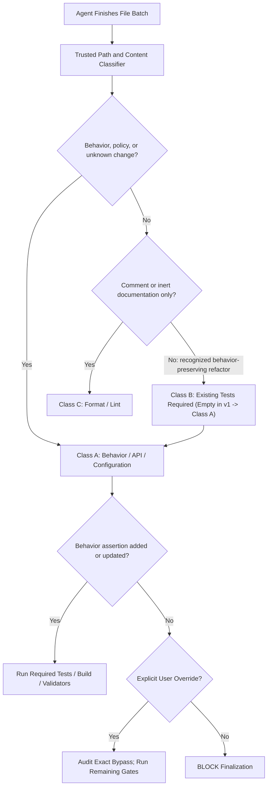

# [ATE-1000] System Architecture Specification: DevCode Harness

```
================================================================================
STANDARD       : ATE-1000 (Automated Technical Engineering Standard Series)
DOCUMENT ID    : ATE-1000-ARCH
REVISION       : 0.4.0-draft
STATUS         : Working Draft (Engineering Specification)
AUTHOR         : DevCode Architecture Group
RELATED DOCS   : [docs/prd.md](prd.md), [docs/codebaseunderstanding.md](codebaseunderstanding.md)
================================================================================
```

---

## 1.0 System Overview & Engineering Philosophy

**DevCode** is an autonomous, developer-centric agentic CLI harness built for disciplined software engineering. 

Rather than boxing developers into forced state-machine ceremonies or making unachievable claims about OS sandboxing, DevCode is built on a **Single Agent Loop with Dynamic Policy Profiles**, **Deterministic Verification Gates**, and **Transparent Security Boundaries**.

```
+------------------------------------------------------------------------------------+
|                               DEVCODE SYSTEM HARNESS                               |
+------------------------------------------------------------------------------------+
|                                                                                    |
|  +-------------------+       +--------------------------------------------------+  |
|  | CLI / TUI UX      |       | UNIFIED AGENT CORE                               |  |
|  | - Diff Inspector  | ----> | - Single continuous agent loop                   |  |
|  | - Profile Switch  |       | - Context Assembler (ATE-1002 Dual-Tier)         |  |
|  | - Manifest Rolls  |       | - Context Compaction & Sliding Window Manager    |  |
|  +-------------------+       +-------------------------+------------------------+  |
|                                                        |                           |
|                                                        v                           |
|  +--------------------------------+         +-----------------------------------+  |
|  | PRAGMATIC RUNTIME BOUNDARIES   |         | INDEPENDENT VERIFICATION GATES    |  |
|  | - FS Allowlist (realpath)      | <-----> | - Rule-Based Path Classifier      |  |
|  | - Step Manifest Rollback       |         | - Test Gate (Class A/B/C)         |  |
|  | - Credential Env Stripping     |         | - Linter / Compiler Gates         |  |
|  | - Process Tree Watchdog        |         | - SAST Orchestrator (Semgrep)     |  |
|  | - Linux bwrap net (opt-in)     |         | - Append-Only Audit Log           |  |
|  +--------------------------------+         +-----------------------------------+  |
|                                                                                    |
+------------------------------------------------------------------------------------+
```

### Core Architecture Tenets
1. **Modes as Policy & Permission Profiles, Not Control Flow**: Modes (`ask`, `plan`, `build`, `debug`, `security`) are lenses that alter prompting emphasis and tool permissions. The execution engine remains a single fluid loop.
2. **The Differentiator is the Gate**: Anyone can generate code; DevCode blocks harness finalization until required checks pass or the user explicitly authorizes an audited override. Edits remain provisional on disk during verification; external Git commands are outside this gate.
3. **No Self-Grading Gates**: The model cannot classify its own edits as "exempt" to bypass testing. File classification is evaluated by deterministic path rules and AST heuristics.
4. **Honest Engineering Boundaries**: No claims of magical "air-tight process isolation" on platforms that do not support it. Boundaries are defined as strict path allowlists, credential stripping, process timeouts, and opt-in Linux namespaces.
5. **Zero Mutation of User State**: Checkpoints rely on **Step Manifests and selective working-tree restores**, preserving pre-step content even in touched files and never modifying the developer's staged index. Concurrent edits cause rollback conflicts rather than silent overwrites.

---

## 2.0 Subsystem Decomposition

```
+---------------------------+------------------------------------------------------------------------+
| Subsystem                 | Architectural Responsibility                                           |
+---------------------------+------------------------------------------------------------------------+
| 1. Profile Controller     | Injects mode-specific system prompts, tool allowlists, and gate rules. |
| 2. Context Engine         | Dual-Tier Graph (JIT ripgrep + threshold-gated AST PageRank).          |
| 3. Step Manifest Engine   | Tracks file mutations (created, modified, deleted) for safe rollback.  |
| 4. Runtime Guard          | Enforces FS allowlists, credential env stripping, and tree timeouts.   |
| 5. Gatekeeper & Auditing  | Evaluates file classifications, runs linters/tests, and logs overrides.|
| 6. Configuration Loader   | Parses `.devcode.json` project config for build/test/lint commands.   |
+---------------------------+------------------------------------------------------------------------+
```

---

## 3.0 Modes as UX & Permission Profiles

Instead of a forced multi-state transition graph that interrupts developer flow, DevCode implements modes as **behavioral profiles** governing tool permissions and verification rigor:

```
+-------------------+--------------------+----------------------------------+---------------------------------------+
| Mode Profile      | FS Permissions     | Network Access                   | Enforced Verification Gate            |
+-------------------+--------------------+----------------------------------+---------------------------------------+
| `ask`             | Strictly Read-Only | Unrestricted (Env stripped)      | None (answers only)                   |
| `plan`            | Strictly Read-Only | Unrestricted (Env stripped)      | Structured task specification output  |
| `build` (Default) | Scoped Read/Write  | Unrestricted (Env stripped)*     | Typecheck + Linter + Test Gate (TDD)  |
| `debug`           | Scoped Read/Write  | Unrestricted (Env stripped)*     | Minimal Reproducer Test (Red -> Green)|
| `security`        | Read-Only (Agent)* | Unrestricted (Local DBs cached)  | Secret scan (Gitleaks) + SAST Semgrep |
+-------------------+--------------------+----------------------------------+---------------------------------------+
```
*\*On Linux, network can be strictly unshared via `bwrap --unshare-net` if enabled in `.devcode.json`. On macOS/Windows, socket creation is unrestrained at the OS level; credentials and tokens are stripped from the process environment. In `security` profile, the agent is strictly read-only; remediation patches are applied by the harness upon explicit user approval.*

### 3.1 Profile Definitions
- **`ask` Profile**: Question-answering over the codebase using the same read-only tools as `plan` (`Glob`, `Grep`, `FileRead`, `RepoMap`). Write and mutating shell tools are disabled at the tool schema level. Produces no specification and runs no verification gate. If the user asks for a change, the agent answers and names the profile to switch to (`/build`, `/debug`, `/plan`); it never switches itself.
- **`plan` Profile**: Maximizes read-only exploration tools (`Glob`, `Grep`, `FileRead`, `RepoMap`). Write and shell mutation tools are disabled at the tool schema level.
- **`build` Profile**: Unlocks surgical file edits. Automatically triggers the Verification Gate upon completion of any file batch.
- **`debug` Profile**: Focuses prompt attention on hypothesis testing and minimal reproduction scripts before modifying target code.
- **`security` Profile**: Orchestrates local security scanners (Gitleaks, Semgrep, osv-scanner) with read-only filesystem access. File-modification and mutating shell tools are disabled at the tool schema level. When vulnerabilities or secrets are detected, the agent outputs remediation diffs formatted as structured unified patches. The harness presents the diff to the developer for interactive review; upon explicit user acceptance, the harness (not the agent) applies the patch under step-manifest capture and runs the security gate to confirm resolution. If complex changes or test additions are needed, the developer switches to `/build`.

---

## 4.0 Step Manifest Checkpointing & Safe Rollback

To preserve staged, unstaged, and untracked work independently of Git history, DevCode implements a **Manifest-Driven Snapshot Engine**:

```
                  [ Developer Working State ]
            (May have uncommitted staged or unstaged edits)
                               |
                               | Task begins
                               v
             +------------------------------------+
             | Step 1: Persist State and Manifest |
             | - Record current HEAD commit SHA   |
             | - If target file exists: persist   |
             |   pre-step bytes and metadata      |
             | (Index and working tree untouched) |
             +-----------------+------------------+
                               |
                               | Agent executes surgical edits
                               v
             +------------------------------------+
             | Step 2: Record Post-Step State     |
             | <session_id>/<step_id>.json        |
             | {                                  |
             |   "created": ["src/new_util.ts"],  |
             |   "modified": ["src/app.ts"],      |
             |   "deleted": []                    |
             | }                                  |
             +-----------------+------------------+
                               |
           +-------------------+-------------------+
           | (Checks pass & user accepts)          | (Checks fail or user rejects diff)
           v                                       v
[ Changes Retained in Tree ]             [ Execute Safe Rollback ]
                                         1. Check post-step state for conflicts
                                         2. Restore persisted pre-step state
                                         3. Preserve concurrent edits on conflict
                                         4. Staged index remains 100% untouched
```

### 4.1 Rollback Algorithm
Before the first mutation of each path in a batch, persist its existence, file type, exact bytes (or symlink target), permission bits, and content hash under the session checkpoint. A hash alone is not a recoverable backup. Publish the manifest before allowing the mutation; if capture fails, block the write. `HEAD` is diagnostic metadata only and may be absent in an uninitialized repository.

When a rollback is triggered (via `devcode rollback` or gate failure rejection):
1. **Conflict Preflight**: Compare every affected path with its recorded post-step state, including existence, type, content, and permissions. If any path differs, stop before restoring any paths, retain the checkpoint, and report the conflict. Do not overwrite or delete concurrent user edits. A batch with unknown writes or incomplete post-step records requires recovery review rather than automatic rollback.
2. **Created Files**: Remove a path only if it was absent before the step and still matches the recorded agent-created state. Existing untracked files are modified files, not created files.
3. **Modified and Deleted Files**: Restore exact pre-step bytes, file type, symlink target, and permissions from persisted records. Never restore from `HEAD` or the staged index. Treat a rename as a captured deletion plus creation.
4. **Guarantee**: Successful rollback restores touched paths to pre-step state, preserves unrelated paths, and leaves the staged index untouched. Restore steps in reverse order; older steps cannot be restored over later changes.
5. **Recovery Failure**: Revalidate paths against the workspace boundary before restoration, do not follow symlinks outside it, and retain checkpoint data after any I/O failure. Report partial recovery explicitly; never report success until restored state is verified.

Harness-mediated file tools (`write_file`, `edit_file`, `patch`) must capture every path mutation in the step manifest before write. Shell subprocess writes follow §6.4: structured edit tools own source/config changes; every mutation-capable shell command runs after a guard-set snapshot (§6.4.5), so shell changes to non-ignored workspace files are restorable. Gitignored files, oversize files, and paths outside the workspace are not; do not advertise rollback for them.

### 4.2 Checkpoint Retention & Garbage Collection
- Checkpoint manifests and blob references are stored locally under `.devcode/manifests/<session_id>/`.
- **Retention**: Retains the last 20 completed steps per session plus active or unresolved recovery steps.
- **Expiration**: Completed, inactive manifests older than 7 days are pruned on session initialization. Active steps and unresolved recovery conflicts retain their manifests and referenced blobs.
- **Manual Cleanup**: `devcode gc` purges eligible stale manifests and unreferenced blobs. Never evict a required backup to meet the disk budget; block new mutations if a checkpoint cannot be stored safely.

---

## 5.0 Deterministic Gatekeeper & Classification Protocol

To prevent the **"Gate Grades Itself" vulnerability** (where the generating model labels its own breaking code as "Class C: Docs/Exempt"), classification is enforced by a **Rule-Based Path & AST Classifier**:



### 5.1 Classification Rules
1. **Class A (Behavior / API / Configuration)**: Any change affecting executable behavior, interfaces, dependencies, compiler settings, build scripts, CI workflows, permissions, deployment, or verification policy requires a new or updated assertion of the changed behavior plus applicable tests, build checks, and validators. Configuration assertions may be fixture checks or dry-run validation; a parser/schema check alone does not establish behavior.
2. **Class B (Invariance/Refactor - Declared Empty in v1)**: In v1, Class B is explicitly empty; no transformations qualify automatically. Without deterministic AST equivalence provers, treating agent-claimed "refactors" as exempt from new assertions creates an unacceptable self-grading loophole. Therefore, in v1, all code changes default to Class A (requiring new or updated assertions) unless they meet Class C (strictly inert documentation/whitespace/comments). Class B is reserved for future releases backed by formal AST verification (e.g., Tree-sitter verified type-annotation additions with zero runtime emit diff, LSP-verified local identifier renames, or deterministic import sorting). Developers performing behavior-preserving refactors in v1 must either touch/update an existing assertion or authorize an audited bypass via `--skip-tests`.
3. **Class C (Inert Content)**: Only verified documentation, plain text, or comment/whitespace-only changes with no executable or policy effect qualify for format/lint-only checks. File extensions and `docs/**` placement never establish exemption by themselves. Executable examples, ignore rules, and configuration embedded in documentation require impact classification.
4. **Conservative Default**: Unknown formats, unsupported parsers, parse failures, mixed changes, and ambiguous impact default to Class A. Apply the strictest applicable class to the batch. Missing validators block finalization unless explicitly bypassed by the user and audited.
5. **Trusted Policy Baseline**: Load gate commands and classification policy from the user-approved pre-step configuration. Changes to `.devcode.json`, test discovery, CI policy, or gate scripts cannot weaken their own checks. Validate proposed policy changes using the baseline; activate them only after explicit user acceptance. Model text and repository content cannot authorize an override.
6. **Bound Verification Results**: Record the checked diff hash, commands, and outcomes. Any subsequent source, configuration, or test change invalidates affected results. A new test file alone is insufficient: the configured runner must discover and execute the behavior assertion successfully.

### 5.2 Append-Only, Tamper-Evident Audit Log
Every time an enforcement check is bypassed via `--skip-tests` or an explicit user instruction identifying the bypass, DevCode appends a non-interactive record to `.devcode/audit.log`:
```json
{
  "timestamp": "2026-11-23T15:25:00Z",
  "action": "OVERRIDE_SKIP_TESTS",
  "actor": "user_cli_flag",
  "modified_files": ["src/payment/processor.ts"],
  "diff_sha": "a1b2c3d4...",
  "prev_entry_sha": "9f8e7d6c...",
  "reason": "Hotfix emergency bypass"
}
```
**Harness State Protection & Truncation Anchor**: `.devcode/` (`audit.log`, `manifests/`) is written only by the harness process. The runtime guard (§6) denies every agent file-tool write, edit, delete, and rename under `.devcode/` in all profiles, including via symlinks resolved by `realpath`. Each entry carries `prev_entry_sha`, the SHA-256 of the preceding entry.

To prevent an adversary or shell subprocess from truncating or completely deleting `.devcode/audit.log` to erase past bypasses, DevCode anchors the tail hash in two isolated locations outside the agent-writable repository tree:
1. **User Local State Anchor**: Stored in the per-user state directory outside the workspace (`~/.local/state/devcode/anchors/<repo_uuid>.json` on Linux/macOS, `%LOCALAPPDATA%\devcode\anchors\<repo_uuid>.json` on Windows). Records `{"repo_uuid": "...", "entry_count": N, "last_entry_sha": "...", "updated_at": "..."}`.
2. **Private Git Ref Anchor**: When the workspace is a Git repository, the harness writes the latest tail SHA and count to a private ref (`refs/devcode/audit-tail`). This ref is outside the standard working tree and staging index, and is never touched by agent file tools.

**Tamper Detection Rules**:
At session startup and prior to finalizing any verification gate:
- If `.devcode/audit.log` is absent or empty, but the anchor records `entry_count > 0`: the harness blocks finalization with a fatal error (`AUDIT_LOG_DELETED`).
- If the count of entries in `audit.log` is less than `entry_count`: the harness blocks finalization (`AUDIT_LOG_TRUNCATED`).
- If any `prev_entry_sha` does not match the previous record's SHA-256, or the final record does not match `last_entry_sha`: the harness blocks finalization (`AUDIT_CHAIN_BROKEN`).

On macOS and Windows there is no OS-level filesystem isolation (§6.1), so a shell subprocess could still modify `.devcode/`. The guarantee is therefore tamper-evident, not tamper-proof; any tampering or deletion prevents further automated completions. Shell write policy is specified in §6.4.

---

## 6.0 Pragmatic Runtime Boundaries & Threat Model

```
+----------------------------------------------------------------------------------+
|                            PRAGMATIC RUNTIME GUARD                               |
+----------------------------------------------------------------------------------+
|                                                                                  |
|  [ Tool Invocation: run_command / write_file ]                                   |
|                          |                                                       |
|                          v                                                       |
|  +---------------------------------------------------+                           |
|  | 1. Filesystem Path Canonicalization (realpath)     |                          |
|  | - Enforces all writes stay inside workspace root. |                           |
|  | - Blocks symlink escapes and paths to ~/.ssh, etc.|                           |
|  +-----------------------+---------------------------+                           |
|                          | Allowed                                               |
|                          v                                                       |
|  +---------------------------------------------------+                           |
|  | 2. Policy Engine & Approval Bus (with UX Rail)    |                           |
|  | - Authoritative: Profile policy + user approvals. |                           |
|  | - Advisory UX rail: Fast-blocks obvious accidents |                           |
|  |   (e.g., rm -rf /, dd, shutdown, mkfs).           |                           |
|  +-----------------------+---------------------------+                           |
|                          | Allowed                                               |
|                          v                                                       |
|  +---------------------------------------------------+                           |
|  | 3. Subprocess Execution & Environment Strip       |                           |
|  | - Strips AWS_*, GITHUB_TOKEN, *_API_KEY, SSH_*    |                           |
|  | - Spawns in dedicated process tree                |                           |
|  | - Wall-clock timeout watchdog (default: 30s)      |                           |
|  | - Abort kills whole tree (SIGKILL / Job)          |                           |
|  +---------------------------------------------------+                           |
|                                                                                  |
+----------------------------------------------------------------------------------+
```

### 6.1 Honest Security Claims
- **Network**: DevCode does **not** claim kernel-level network isolation on macOS or Windows. Sockets can be opened by child processes. Security is provided by **environment stripping** (removing API tokens and cloud credentials from process env). On Linux, true network isolation (`bwrap --unshare-net`) can be enabled if `bubblewrap` is installed.
- **Command Blacklist as UX Safety Rail, Not Hard Security**: A pattern or regex blacklist (e.g., blocking `rm -rf /`, `dd`, `shutdown`, `mkfs`) is strictly an advisory UX guardrail to catch obvious catastrophic accidents. It is **not** an authoritative security boundary: shell string matching can be trivially bypassed via string concatenation, base64 encoding, script evaluation, subshells, or aliases. The true controls are profile permissions (disabling mutating tools in `ask`/`plan`/`security`), path canonicalization (`realpath`), environment stripping, and the **Policy Engine & Approval Bus** which prompts the developer or blocks unauthorized command execution.
- **Threat Model**:
  - *Addressed*: Accidental destructive commands (`rm -rf`), runaway CPU processes, directory traversal outside workspace, accidental leakage of local environment tokens into child processes.
  - *Not Addressed (Out of Scope)*: Zero-day kernel exploits, hostile root users, hardware side-channel attacks. DevCode is a developer tool, not an untrusted multi-tenant cloud container.

### 6.2 Cross-Platform Runtime Matrix
Tier 1 targets (design decision): macOS (arm64, x86_64), Linux (x86_64, aarch64; glibc and musl), Windows 11 native (x86_64). Windows arm64 runs the x86_64 build under emulation until a native build is justified. WSL2 is treated as Linux. Every OS-specific behavior sits behind one platform abstraction; the agent loop, gates, and classifier contain no OS branches.

| Concern | macOS / Linux | Windows | Spec rule |
| :--- | :--- | :--- | :--- |
| Process tree kill | `setpgid` + `killpg` (SIGTERM, then SIGKILL) | Unprivileged Win32 Job Object with `JOB_OBJECT_LIMIT_KILL_ON_JOB_CLOSE` | FR-4.3 / NFR-8 hold on every Tier 1 OS without administrator elevation |
| Path canonicalization | `realpath`; APFS is case-insensitive by default and normalizes Unicode | Normalize shell drive paths (`/c/` -> `C:\`), resolve to the final long path (8.3 names, junctions, symlinks) per §6.4.4 and reject reserved device names (`CON`, `NUL`) | Compare platform-normalized canonical paths. The `.devcode/` deny rule and the workspace allowlist use the same normalization |
| Symlinks | Native | Creation may need privilege; junctions differ | Manifest records link type and target. Restore failure is reported per FR-3.5, never skipped silently |
| Permission capture | POSIX mode bits | Read-only and hidden attributes; ACLs not captured | NFR-6 parity covers bytes, type, and POSIX mode or Windows attributes. ACL fidelity is out of scope and documented |
| Line endings & BOM | Bytes preserved; preserve file EOL | Bytes preserved; preserve UTF-8/UTF-16 BOM and CRLF | Manifests store raw bytes; file tools preserve existing BOM and CRLF |
| File replace | Atomic `rename` | Replace retries with backoff on locked files (`ERROR_SHARING_VIOLATION`) | Locked-file failure blocks the write or reports partial rollback per FR-3.5; never overwritten blind |
| Env stripping | Case-sensitive names | Case-insensitive names | Match credential patterns case-insensitively on Windows |
| Command execution | `sh -c` or argv | PowerShell or `cmd`; argv preferred | Prefer argv spawn over shell strings on every OS |
| Network isolation | Linux: opt-in `bwrap`; macOS: none | None | Unchanged (§6.1) |
| Config and cache | XDG dirs; `~/Library` on macOS | `%APPDATA%` / `%LOCALAPPDATA%` | Per-OS user dirs; harness state stays in repo `.devcode/` |

Open items: native Windows availability of `semgrep`, `gitleaks`, and `osv-scanner` is unverified (§7.3 missing-tool policy applies until it is); the shell write policy is defined in §6.4. Windows runtime architecture is detailed in `DEVCODE-RES-009`.

### 6.3 Distribution & Installation
Primary channel is a one-line installer; other channels (Homebrew, winget, npm, source build) are deferred.

```sh
curl -fsSL https://<install-host>/install.sh | sh        # macOS, Linux, WSL2
irm https://<install-host>/install.ps1 | iex             # Windows (PowerShell)
```

Hosting and release integrity architecture:
- **Beta (current decision)**: `<install-host>` is `<project>.pages.dev` on **Cloudflare Pages**; no purchased domain and no GitHub organization. Cloudflare is chosen over Vercel because Vercel Hobby is restricted to non-commercial personal use (Vercel fair-use guidelines), while Cloudflare Pages documents unlimited static requests and bandwidth on the free plan with a 20,000-file limit [vendor claim, checked 2026-11-24]. The static site serves only `install.sh`, `install.ps1`, and the public key fingerprint. Release archives, `SHA256SUMS`, and `SHA256SUMS.minisig` stay in GitHub Releases of a repository on the maintainer's personal account (`https://github.com/<github-user>/<repo>/releases/download/v<version>/...`). Binaries are never hosted on the site, which keeps it within free-tier size and bandwidth limits [guess].
- **Subdomain names are first come**: as of 2026-11-23, `devcode.pages.dev`, `devcode.vercel.app`, `assay.pages.dev`, and `assay.vercel.app` were already in use. A Vercel project name is claimed only when a project is created; the subdomain must be reserved by creating the project before it is documented.
- **After beta**: a custom domain may point at the same site. Do not document a live `curl | sh` URL for a host DevCode does not control. As of 2026-11-23, `devcode.tools` returned no DNS answer and the GitHub organizations `devcode` and `devcode-ai` belong to unrelated accounts.
- **Account risk**: the site account and the GitHub account each control part of the supply chain. Whoever controls the site controls the installer script and any key embedded in it, so the pinned minisign key protects against a tampered release mirror, not against site or account compromise. Beta mitigations: hardware-key 2FA on both accounts, signed tags, the minisign secret key kept off CI runners, the script served from a repository-built deploy only (no dashboard edits), and the key fingerprint published in the README and in a second place.
- **Signing Standard**: Releases publish `SHA256SUMS` signed via **minisign** (`SHA256SUMS.minisig`) with a pinned Ed25519 public key embedded directly in `install.sh` and `install.ps1`. CI workflows additionally produce Sigstore/cosign provenance attestations; no SLSA level is claimed until the build pipeline is audited against it.

Requirements:
1. **Implementation Language & Self-Contained Binary.** Implemented in **Rust** to deliver a single self-contained native binary per target with no runtime dependency (no Node, Python, or other runtime on the user machine). Rust gives direct access to Win32 Job Objects and POSIX process groups. Startup (NFR-1/2) is a benchmark outcome to measure, not a property of the language. Library choices (for example `gix`, `tree-sitter`) are undecided; `tree-sitter` is a C library with Rust bindings.
2. **POSIX `sh` only.** The script must run under `dash`, `bash`, and `zsh` when piped to `sh`; no bashisms. Wrap the body in a function invoked on the last line so a truncated download cannot execute a partial script.
3. **Detection.** OS, CPU architecture, and libc (glibc vs musl, including Alpine and Termux). Handle Rosetta 2 (x86_64 shell on Apple Silicon) and Windows-on-ARM shells that report x86_64.
4. **Integrity & Verification.** Download the release asset, `SHA256SUMS`, and `SHA256SUMS.minisig`; verify the checksum against `SHA256SUMS` and verify the signature using the embedded Ed25519 public key before extracting. Abort and delete all artifacts on mismatch.
5. **No privilege.** Install to a user-writable directory (default `~/.local/bin`; `%LOCALAPPDATA%\Programs\devcode` on Windows); never call `sudo`.
6. **Idempotent and reversible.** Re-running upgrades in place. `--version <v>` pins a release. `--no-modify-path` skips shell-profile edits; otherwise append to the profile once and only when the directory is absent from `PATH`. `devcode uninstall` removes the binary and PATH edit; it never touches `.devcode/` in any repository.
7. **Hygiene.** Temp files live in a `mktemp` directory removed on exit and on failure. The installer never executes downloaded code other than the verified binary's `--version` smoke test, and sends no telemetry.
8. **Upgrade path.** `devcode upgrade` reuses the same download and verification code.

Reference-study evidence (code): codex ships `install.sh` and `install.ps1` with a `SHA256SUMS` check; goose ships `download_cli.sh` and `download_cli.ps1` with no checksum step and uses bash-only syntax; opencode's installer handles Rosetta, musl, and AVX2 baseline builds.

### 6.4 Shell Write Policy & Subprocess Mutation Model

#### 1. The Core Tension
Step-manifest rollback (PRD FR-3) requires capturing pre-step bytes, permissions, and hashes before mutations take place. For harness-mediated file tools (`write_file`, `edit_file`, `replace`), this pre-step capture is exact and synchronous.
However, for shell subprocesses (`run_command`), the written paths are unknown ahead of execution, and per-path pre-step capture is impossible without kernel-level filesystem redirection (e.g., Linux overlayfs or fanotify). §5 below closes the gap by snapshotting the whole guard set before the command. On macOS and Windows (Tier 1 platforms per FR-6.1), requiring pre-step capture or blocking all uncapturable shell writes would **freeze all build and test tools** (`cargo build`, `npm test`, `pytest`, `go test`, `dotnet build`, `make`). These commands routinely emit build artifacts, compiler caches, and temporary files. Freezing them renders the harness unusable.

#### 2. Separation of Tools
DevCode resolves this tension through strict operational separation:
1. **Agent File Tools (Sanctioned Mutation Path)**:
   - Agent modifications to source code, test files, configs (`.devcode.json`, CI scripts, lockfiles), and documentation MUST use harness file tools.
   - The runtime guard intercepts these calls, canonicalizes paths (`realpath`), verifies workspace boundaries, excludes `.devcode/`, and persists pre-step bytes in `.devcode/manifests/<session_id>/<step_id>.json` before applying the edit.
2. **Shell Subprocesses (`run_command`)**:
   - Authorized for reading, compiling, building, and running test/validation suites.
   - Allowed to write to derived build directories (e.g., `target/`, `build/`, `dist/`, `.cache/`, `node_modules/`, `__pycache__/`) and system temp locations (`/tmp`, `%TEMP%`).
   - Monitored by the runtime guard to prevent direct shell bypass of source file tracking and harness state protection.

#### 3. Lexical Guarding against Shell Evasion
To prevent models or scripts from laundering file edits or tampering with `.devcode/` through shell commands:
1. **Heredoc Stripping**: Following Qwen Code PR #9417 / `daemon-git-worktree-guard.ts`, heredocs (`<<[-]WORD ... WORD`) are stripped prior to lexical analysis so that multiline script bodies or delimiter text cannot mask shell redirection operators or command chains.
2. **Redirection Blocking**:
   - POSIX shell operators (`>`, `>>`, `&>`, `>|`) targeting `.devcode/` or tracked repository source files are blocked before spawn.
   - Direct file writing utilities (`cat <<EOF >`, `tee`, `cp`, `mv`) targeting protected paths or source files are denied; the agent is instructed to use file tools instead.
3. **Canonicalization**: Target paths within redirection commands are canonicalized against the workspace root to prevent symlink traversal and relative path tricks (`../`).

#### 4. Windows-Specific Shell Write Policy
On Windows 11 native (x86_64):
1. **Shell Variant Coverage**: Both PowerShell (`pwsh.exe`, `powershell.exe`) and `cmd.exe` command shapes are parsed:
   - PowerShell redirection (`>`, `>>`, `2>&1`, `*>&1`) and cmdlets (`Out-File`, `Set-Content`, `Add-Content`, `Tee-Object`, `Export-Clixml`) targeting `.devcode/` or tracked sources are blocked.
   - PowerShell heredocs/herestrings (`@" ... "@`, `@' ... '@`) are stripped before parsing cmdlet pipelines.
2. **Case Insensitivity & Short Names**:
   - Path checks for `.devcode/` match case-insensitively (`.DEVCODE`, `.DevCode`).
   - **Canonical form**: resolve the path with `GetFinalPathNameByHandle` (flag `VOLUME_NAME_DOS`), which expands 8.3 short names (`DEVCOD~1`), junctions, and symlinks. The call returns an extended-length path with a `\\?\` prefix. Strip `\\?\` from `\\?\C:\...`, and rewrite `\\?\UNC\server\share\...` to `\\server\share\...`. Canonical forms are compared only after this normalization, so the prefix is never a reason to reject a path.
   - **Targets that do not exist yet** (new files): canonicalize the nearest existing parent the same way, check the rule, then append the validated final component.
   - **Containment**: canonicalize the workspace root with the same function. A path is allowed only if the canonical root is a case-insensitive path-component prefix of the canonical target. The `.devcode/` deny rule uses the same comparison.
   - **Rejected**: Win32 device names (`CON`, `PRN`, `AUX`, `NUL`, `COM1..9`, `LPT1..9`), device-namespace paths (`\\.\`, `\\?\GLOBALROOT`, `\\?\Volume{...}` that do not resolve to a drive letter), and any network UNC path unless the canonical workspace root is itself on that share.
3. **Locked File Handling**: Windows enforces strict mandatory file locking (`ERROR_SHARING_VIOLATION` / `ERROR_LOCK_VIOLATION`). If a build process or language server holds a handle on an artifact, harness rollback will not crash or corrupt files; it retries with exponential backoff (up to 1.5s) and reports partial recovery per FR-3.5 if the file remains locked.
4. **Process Tree Eradication**: Windows uses Win32 Job Objects configured with `JOB_OBJECT_LIMIT_KILL_ON_JOB_CLOSE`. When the 30-second watchdog timer trips or a command aborts, closing the Job Object handle terminates all child and grandchild processes instantly, eliminating orphaned daemons without depending on POSIX signals.

#### 5. Pre-Command Workspace Snapshot & Post-Command Reconciliation
Pre-step capture of an unknown write set is solved by capturing the whole **guard set** before any command that can write. This replaces the earlier `git status` check, which fails in non-git repositories, cannot tell whether a command changed an already-dirty file, and restores nothing.

**Command classes** (argv-parsed, then lexical analysis for shell strings):
1. **Read-only allowlist** (for example `ls`, `cat`, `rg`, `git status`, `git diff`, `git log`): no snapshot. Any redirection, unknown flag, or pipe into a non-allowlisted command moves the command to class 2.
2. **Mutation-capable** (everything else, including build and test commands): snapshot before, reconcile after.
3. **Destructive patterns** (`rm`, `mv`, `sed -i`, `git clean`, `git checkout --`, `git restore`, `git reset --hard`, `git stash`): always routed to the Policy Engine as ASK, whatever the profile or prior approvals. The prompt states whether the target set lies inside the guard set.

**Guard set**: every non-ignored file in the workspace root, tracked or untracked, excluding `.devcode/`. Ignore rules come from `.gitignore` (and nested ignore files); without Git, from the derived-directory list in §2. Per-file cap 10 MB; larger files are outside the guard set and reported as unprotected.

**Snapshot procedure**:
1. Fingerprint each guard-set path: type, size, mtime (ns), mode or Windows attributes.
2. Hash and store bytes only for paths whose fingerprint differs from the last stored snapshot of the session. The first snapshot reads every file; later ones are incremental. Blobs are content-addressed under `.devcode/` and shared with step manifests, so disk use falls under the NFR-7 ceiling.
3. Publish the pre-step record in the step manifest before spawning the command (FR-3.1 applies unchanged).

**Budget**: at most 5,000 guard-set files, and unique blob bytes within the NFR-7 ceiling (shared with manifests). Both numbers are untested starting values [guess]; NFR-9 sets the time limit. If the budget is exceeded or a file cannot be read (for example a Windows sharing violation), the command is blocked (FR-3.5). The user may approve running it **without rollback protection**; the harness appends an `OVERRIDE_NO_SNAPSHOT` entry to the audit log (§5.2) listing the unprotected paths, and the step manifest marks the step `rollback: unavailable`.

**Post-command reconciliation**:
1. Re-fingerprint the guard set; hash only changed paths. Record created, modified, and deleted paths as the step's post-state.
2. If any tracked or guard-set source or configuration file changed: invalidate all prior verification results (Gates 1–5, PRD FR-2.2), assign the batch to Class A, and re-run gates.
3. Rollback restores shell-changed paths from the stored blobs under the FR-3.4 conflict preflight (post-state comparison, reverse order, never `HEAD` or the index). Shell-created files are removed only if still unchanged since the command.
4. Derived build artifacts in ignored paths are not restored; clean them with project commands (`cargo clean`, `npm run clean`), never `git clean -fd`.

**Not protected, stated plainly**:
- Gitignored files (including `.env`, local databases, `node_modules`, build outputs), files over the size cap, and any path outside the workspace root.
- External effects: network calls, remote Git operations, databases, other processes.
- Writes by the command to the guard set that the harness cannot attribute because the user edited the same path during the command: reported as a conflict, never overwritten.
On macOS and Windows the harness cannot prevent a shell command from writing outside the workspace; Policy Engine approval and environment stripping are the only controls (§6.1).

---

## 7.0 Agent Loop Internals & Configuration Schema

### 7.1 Context Window Compaction & Overflow Management
When session conversation history exceeds $75\%$ of the model's active context window:
1. **Compaction Strategy**: Previous turn pairs (user instruction + raw tool output) are compressed into a structured summary:
   - Goals attempted and files modified.
   - Key test/compiler outputs retained; verbose logs dropped.
2. **Working Set Priority**: The active Step Manifest, current file diffs, and project configuration are pinned and never evicted during compaction.

### 7.2 Diff Rejection Workflow
When a proposed diff is presented to the user and rejected:
1. **Option A (Rollback)**: Revert working tree via Step Manifest to pre-step state.
2. **Option B (Refine)**: Retain current file state, ingest user corrective feedback, and re-enter the loop.

### 7.3 Missing Tool Policy
When a gate tool (e.g., `semgrep`, `gitleaks`, `pytest`, `eslint`) is missing from `$PATH`:
- **Interactive Mode**: Offers installation, abort, or an explicit audited bypass identifying the missing check. A warning alone never counts as a passed gate.
- **Strict CI Mode (`--strict`)**: Immediately **BLOCKS** the gate with exit code 1.

### 7.4 Configuration Schema (`.devcode.json`)
Placed at project root to define build, test, and verification commands:
```json
{
  "$schema": "<schema-url>",
  "project_name": "my-service",
  "verification": {
    "test_command": "npm test -- --bail",
    "lint_command": "npm run lint",
    "format_command": "npm run format:check",
    "typecheck_command": "npx tsc --noEmit"
  },
  "security": {
    "sast_tool": "semgrep",
    "secret_tool": "gitleaks",
    "dependency_tool": "osv-scanner",
    "strict_mode": false
  },
  "sandbox": {
    "timeout_seconds": 30,
    "linux_unshare_network": false
  }
}
```

---

## 8.0 Non-Goals

1. **Not a General-Purpose Chatbot**: DevCode is not designed for conversational entertainment; every interaction maps to engineering tasks and actionable diffs.
2. **Not a Multi-Tenant Cloud Sandbox**: It runs locally with developer privileges; it does not replace Docker/microVMs for running untrusted third-party code.
3. **Not an IDE Replacement**: DevCode operates in the terminal and integrates with your existing editor (VS Code, Neovim, JetBrains) via file interfaces.

---

## 9.0 Normative References & Traceability

- **Product Requirements**: [docs/prd.md](prd.md) (ATE-1001-PRD)
- **Codebase Understanding**: [docs/codebaseunderstanding.md](codebaseunderstanding.md) (ATE-1002-CBU)
- **Reference Catalog**: [references/README.md](../references/README.md) (ATE-1003-REF)
- **Empirical Research Series**: [docs/research/](research/) (DEVCODE-RES-001 through DEVCODE-RES-010; informative)
