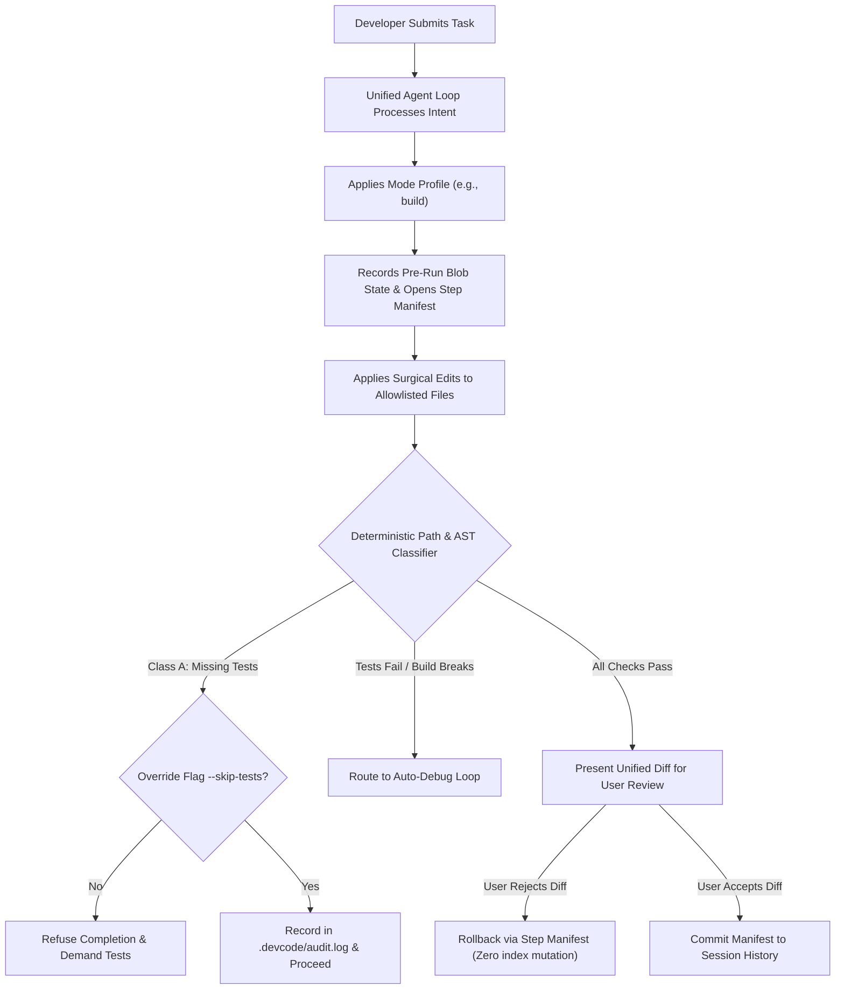

# [ATE-1001] Product Requirements Document: DevCode Harness

```
================================================================================
STANDARD       : ATE-1000 (Automated Technical Engineering Standard Series)
DOCUMENT ID    : ATE-1001-PRD
REVISION       : 0.3.0-draft
STATUS         : Working Draft (Engineering Specification)
AUTHOR         : DevCode Product Architecture Group
RELATED DOCS   : [docs/devcode.md](devcode.md), [docs/codebaseunderstanding.md](codebaseunderstanding.md)
================================================================================
```

---

## 1.0 Product Vision & Purpose

**DevCode** is an autonomous, developer-centric agentic CLI harness built for disciplined software engineering. 

Rather than boxing developers into forced state-machine ceremonies, DevCode operates as a **single responsive agent loop** equipped with **dynamic permission profiles (`plan`, `build`, `debug`, `security`)** and **deterministic verification gates**. Its core differentiator is not conversational output, but the uncompromising enforcement of quality gates before harness finalization. Edits are provisional on disk while checks run; external Git operations are outside harness enforcement.

For architectural design and sandbox runtime specifications, see [docs/devcode.md](devcode.md). For codebase indexing and graph mechanics, see [docs/codebaseunderstanding.md](codebaseunderstanding.md).

---

## 2.0 User Personas & Core Workflows

| Persona | Core Pain Point | DevCode Solution |
| :--- | :--- | :--- |
| **Full-Stack Engineer** | AI tools churn out untested code that breaks downstream builds or silently alters behavior. | Class-based test enforcement gates, atomic diff reviews, and compiler pass verification. |
| **Systems / Platform Engineer** | Accidental index overwrites and tool-driven destructive file edits destroy local work. | Non-destructive Step Manifest rollbacks and strict filesystem allowlists. |
| **Security Engineer** | AI models introduce subtle security flaws and hardcoded credentials. | Integrated orchestration of proven SAST and secret scanning tools (`semgrep`, `gitleaks`). |

---

## 3.0 Functional Requirements (FR)

### FR-1: Unified CLI Loop with Dynamic Policy Profiles
- **FR-1.1**: DevCode shall execute a single continuous agent loop, accepting user instructions without forcing state transitions.
- **FR-1.2**: Mode profiles (`plan`, `build`, `debug`, `security`) shall function as permission and prompt lenses:
  - `plan`: Read-only filesystem, write tools disabled.
  - `build`: Scoped workspace write permissions, verification gates enabled.
  - `debug`: Hypothesis-driven prompting, reproducer assertion requirement.
  - `security`: Read-only analysis, patch generation only.
- **FR-1.3**: The developer may change the active profile at any time via slash commands (`/plan`, `/build`, `/debug`, `/security`) or CLI flags.

### FR-2: Class-Based Test Enforcement Policy
- **FR-2.1 (Rule-Based Classification)**: Apply architecture §5.1 using trusted pre-step policy:
  - **Class A (Behavior / API / Configuration)**: Logic, interfaces, dependency manifests, build/compiler settings, CI, deployment, permissions, and verification policy changes.
  - **Class B (Refactoring)**: Only deterministically recognized behavior-preserving transformations; unchanged signatures and agent labels do not establish invariance.
  - **Class C (Inert Content)**: Verified documentation and comment/whitespace-only changes without executable or policy effect. No extension or directory grants blanket exemption.
  - Unknown formats, parse failures, and ambiguous impact default to Class A; mixed batches use the strictest applicable class.
- **FR-2.2 (Enforcement Rule)**:
  - For **Class A**, block finalization unless a new or updated behavior assertion is discovered and executed successfully, alongside applicable tests, builds, and validators. Configuration changes may use fixture assertions or dry-run checks; syntax/schema validation alone is insufficient.
  - For **Class B**, all applicable existing tests must pass; for **Class C**, formatting/lint checks suffice.
  - Only an explicit user flag or instruction identifying the bypass may authorize an audited exception. Run all remaining gates; a warning or model instruction is not authorization.
  - Bind results to the checked diff hash and invalidate affected checks after subsequent edits.
- **FR-2.3 (Audit Ledger)**: Record each bypass in `.devcode/audit.log` with timestamp, user authorization, skipped checks, reason, and diff SHA.
- **FR-2.4 (Policy Integrity)**: Proposed changes to gate commands, test discovery, or classification rules must be checked using user-approved pre-step policy. They cannot exempt themselves or become active before explicit user acceptance.

### FR-3: Safe Step-Manifest Checkpointing & Rollback
- **FR-3.1**: Before any path mutation, persist pre-step existence, type, exact bytes or symlink target, permissions, and hash. A hash alone is insufficient. Record `HEAD` only as optional diagnostic metadata; block writes if capture fails.
- **FR-3.2**: Publish mutation records under `.devcode/manifests/<session_id>/<step_id>.json` before writing; record post-step state for conflict detection. Capture subprocess writes too, or block commands whose mutations cannot be captured.
- **FR-3.3**: Never mutate the staged index or unrelated paths. Preserve pre-existing unstaged and untracked content even on touched paths.
- **FR-3.4**: Roll back steps in reverse order using persisted pre-step content, never `HEAD` or index content. Before any restore, preflight every touched path against recorded post-step state; abort on concurrent edits or incomplete records. Remove only unchanged agent-created files; restore modified/deleted files with original type and permissions. Revalidate workspace boundaries during recovery.
- **FR-3.5**: Keep active and unresolved recovery checkpoints out of retention pruning. On storage exhaustion block new writes; on recovery I/O failure retain backups and report partial recovery. Verify restored state before reporting success.

### FR-4: Practical Runtime Boundaries & Honest Security Claims
- **FR-4.1 (Filesystem)**: All file writes must be checked against a canonicalized path allowlist strictly limited to the current repository root (`realpath`).
- **FR-4.2 (Network)**: By default, the runtime strips sensitive credentials and tokens (`AWS_*`, `GITHUB_TOKEN`, `*_API_KEY`) from child process environments. On Linux, true network unsharing (`bwrap --unshare-net`) can be enabled via configuration. On macOS/Windows, child processes have standard socket access.
- **FR-4.3 (Process Lifecycle)**: Tool processes must execute inside an isolated Process Group (PGID) bounded by a configurable watchdog timeout (default: 30 seconds), terminating all children on abort with `SIGKILL`.

### FR-5: Orchestrated Security Auditing
- **FR-5.1**: Rather than attempting custom AST taint analysis, DevCode shall orchestrate industry-standard static security tools:
  - Secrets scanning: `gitleaks`.
  - Static vulnerability rules: `semgrep` (OWASP Top 10 rulesets).
  - Dependency CVEs: `osv-scanner` or `trivy`.
- **FR-5.2 (Offline-First Vulnerability DB)**: Security scans must operate offline using locally cached vulnerability databases. Database syncs must occur out-of-band via `devcode security --update-db`.
- **FR-5.3 (Missing Tool Policy)**: If a security tool is missing, interactive mode blocks pending installation, abort, or an explicit audited user bypass; strict mode (`--strict`) blocks the gate.

---

## 4.0 Non-Functional Requirements (NFR) & Concrete Benchmark Recipes

Every NFR has an explicit, reproducible benchmark measurement recipe. NFR-5 applies only after Tier 2 is enabled; rollback and gate acceptance tests are release prerequisites. Active recovery data takes precedence over NFR-7: block new mutations rather than evict needed backups.

```
+-----------------------------------------------------------------------------------------------+
|                                     NFR BENCHMARK MATRIX                                      |
+------------------------+---------------------------+------------------------------------------+
| Metric                 | Target Threshold          | Reproducible Measurement Recipe          |
+------------------------+---------------------------+------------------------------------------+
| NFR-1: Startup Cold    | <= 600 ms                 | Measure time-to-first-prompt on 50k LOC  |
|                        |                           | reference repo (cold OS disk cache).     |
+------------------------+---------------------------+------------------------------------------+
| NFR-2: Startup Warm    | <= 150 ms                 | Time-to-first-prompt on same repo        |
|                        |                           | (warm filesystem cache).                 |
+------------------------+---------------------------+------------------------------------------+
| NFR-3: System Prompt   | Baseline: <= 2,500 tokens | Measure system prompt + repo map token   |
|        Baseline Budget | (Tier 1 = 0, Tier 2 = 2.5k)| count injected before user query.        |
+------------------------+---------------------------+------------------------------------------+
| NFR-4: Tool Context    | Max per turn: <= 6,000 tok| Hard ceiling on file slices and ripgrep  |
|        Assembly Budget |                           | results ingested into model turn.        |
+------------------------+---------------------------+------------------------------------------+
| NFR-5: Tier 2 PageRank | <= 2.0 s                  | Wall-clock time to parse 500 files and   |
|        Compute Time    |                           | compute Personalized PageRank vector.    |
+------------------------+---------------------------+------------------------------------------+
| NFR-6: Rollback        | 100% bit-for-bit parity   | SHA-256 hash comparison of uncommitted   |
|        Fidelity        | on all captured paths        | touched files before vs after rollback.      |
+------------------------+---------------------------+------------------------------------------+
| NFR-7: Checkpoint Disk | <= 50 MB disk usage       | Measure `.devcode/manifests` disk usage  |
|        Ceiling & GC    | (Auto-pruned at 7 days)   | across 50 consecutive interactive runs.  |
+------------------------+---------------------------+------------------------------------------+
| NFR-8: Sandbox Kill    | <= 100 ms to terminate    | Launch `sleep 1000 &` child process;     |
|        Watchdog        | runaway child processes   | verify kill(-pgid) leaves 0 orphans.     |
+------------------------+---------------------------+------------------------------------------+
```

### Reference Benchmark Hardware & Environment
- **Reference Repository**: Standard 50,000 LOC mixed TypeScript/Python repository (1,200 files).
- **Standard Host**: 8-core CPU, 16GB RAM, Apple Silicon or Modern x86 Linux.

---

## 5.0 Acceptance Criteria & Verification Protocol



1. **Gate 1 (Checkpoint Invariance Acceptance Test)**:
   - Setup: Include a partially staged file, a dirty unstaged file, an existing untracked file, and an unrelated dirty file; record content hashes, file types, permissions, and staged index state.
   - Action: Modify the partially staged, unstaged, and untracked files, delete a captured file, create a new file, then roll back. Repeat after restarting the harness to verify persisted recovery data.
   - Verification: All captured paths match pre-step bytes, type, and permissions; only agent-created paths disappear. Staged index and unrelated files remain identical. Excluding harness metadata, `git status --porcelain` matches pre-step state. Repeat without an existing `HEAD`.
2. **Gate 2 (Test Requirement Enforcement Test)**:
   - Editing a Class A source file without adding/modifying tests must trigger an automated refusal unless `--skip-tests` is explicitly provided. Every override must append a verifiable JSON entry in `.devcode/audit.log`.
3. **Gate 3 (Process Group Cleanup Test)**:
   - Commands spawning background sub-processes that exceed timeout thresholds must have their entire process tree eradicated without orphaned daemon processes.

4. **Gate 4 (Concurrent Edit and Recovery Failure Test)**:
   - Change an agent-modified or agent-created path externally before rollback. Verify preflight reports a conflict without altering any paths and retains backups. Inject capture failure and verify no write occurs; inject restore failure and verify partial recovery is reported with backups retained.
5. **Gate 5 (Configuration Gate Integrity Test)**:
   - Change a dependency manifest, compiler setting, CI workflow, and `.devcode.json` test command. Verify Class A applies and pre-step gate commands remain active. Attempt to disable test discovery, label behavior changes as refactoring, and place executable content under `docs/`; verify none receives automatic exemption.
   - Verify inert documentation receives Class C, unknown formats default to Class A, a non-discovered assertion blocks completion, and later edits invalidate prior check results. Explicit user bypasses must identify skipped checks in the audit ledger.

---

## 6.0 Normative References & Traceability

- **System Architecture**: [docs/devcode.md](devcode.md) (ATE-1000-ARCH)
- **Codebase Understanding**: [docs/codebaseunderstanding.md](codebaseunderstanding.md) (ATE-1002-CBU)
