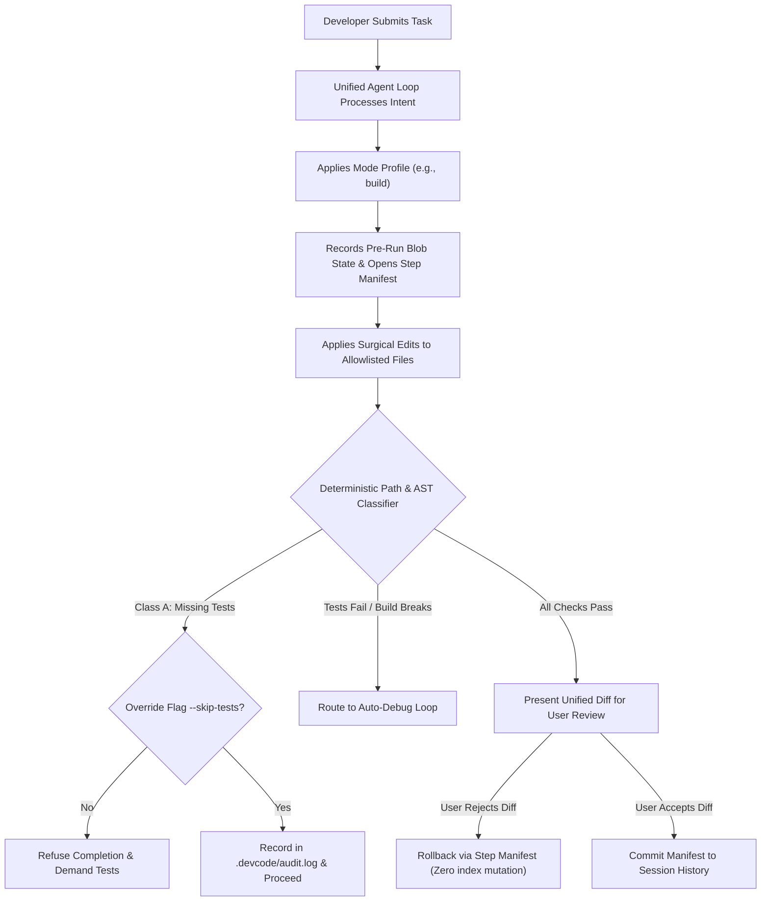

# [ATE-1001] Product Requirements Document: DevCode Harness

```
================================================================================
STANDARD       : ATE-1000 (Automated Technical Engineering Standard Series)
DOCUMENT ID    : ATE-1001-PRD
REVISION       : 0.4.0-draft
STATUS         : Working Draft (Engineering Specification)
AUTHOR         : DevCode Product Architecture Group
RELATED DOCS   : [docs/devcode.md](devcode.md), [docs/codebaseunderstanding.md](codebaseunderstanding.md)
================================================================================
```

---

## 1.0 Product Vision & Purpose

**DevCode** is an autonomous, developer-centric agentic CLI harness built for disciplined software engineering. 

Rather than boxing developers into forced state-machine ceremonies, DevCode operates as a **single responsive agent loop** equipped with **dynamic permission profiles (`ask`, `plan`, `build`, `debug`, `security`)** and **deterministic verification gates**. Its core differentiator is not conversational output, but the uncompromising enforcement of quality gates before harness finalization. Edits are provisional on disk while checks run; external Git operations are outside harness enforcement.

For architectural design and sandbox runtime specifications, see [docs/devcode.md](devcode.md). For codebase indexing and graph mechanics, see [docs/codebaseunderstanding.md](codebaseunderstanding.md).

---

## 2.0 User Personas & Core Workflows

| Persona | Core Pain Point | DevCode Solution |
| :--- | :--- | :--- |
| **Full-Stack Engineer** | AI tools churn out untested code that breaks downstream builds or silently alters behavior. | Class-based test enforcement gates, atomic diff reviews, and compiler pass verification. |
| **Systems / Platform Engineer** | Accidental index overwrites and tool-driven destructive file edits destroy local work. | Non-destructive Step Manifest rollbacks and strict filesystem allowlists. |
| **Security Engineer** | AI models introduce subtle security flaws and hardcoded credentials. | Integrated orchestration of proven SAST and secret scanning tools (`semgrep`, `gitleaks`). |

---

## 3.0 Functional Requirements (FR)

### FR-1: Unified CLI Loop with Dynamic Policy Profiles
- **FR-1.1**: DevCode shall execute a single continuous agent loop, accepting user instructions without forcing state transitions.
- **FR-1.2**: Mode profiles (`ask`, `plan`, `build`, `debug`, `security`) shall function as permission and prompt lenses:
  - `ask`: Read-only filesystem, write tools and mutating shell disabled at the tool schema level. Answers questions about the codebase; no required output artifact and no verification gate. A request to change code is answered with the suggested profile switch, never executed.
  - `plan`: Read-only filesystem, write tools disabled.
  - `build`: Scoped workspace write permissions, verification gates enabled.
  - `debug`: Hypothesis-driven prompting, reproducer assertion requirement.
  - `security`: Read-only filesystem and scanner execution; file write and mutating shell tools are disabled at the tool schema level. Outputs vulnerability reports and remediation patches formatted as structured unified diffs. The harness (not the agent) applies user-approved diffs via step-manifest capture and re-runs security scanners to confirm resolution; alternatively, the developer switches to `build` mode for broader agent-driven remediation.
- **FR-1.3**: The developer may change the active profile at any time via slash commands (`/ask`, `/plan`, `/build`, `/debug`, `/security`) or CLI flags.

### FR-2: Class-Based Test Enforcement Policy
- **FR-2.1 (Rule-Based Classification)**: Apply architecture §5.1 using trusted pre-step policy:
  - **Class A (Behavior / API / Configuration)**: Logic, interfaces, dependency manifests, build/compiler settings, CI, deployment, permissions, and verification policy changes.
  - **Class B (Refactoring - Declared Empty in v1)**: In v1, Class B is explicitly empty. Without language-specific AST invariance provers, admitting model-labeled "refactorings" violates the core tenet of no self-grading gates. All code modifications default to Class A (requiring an assertion of the refactored behavior) unless they qualify as Class C (strictly inert content). Class B is reserved for future versions backed by deterministic AST validation (e.g., Tree-sitter verified type-only annotations or LSP-verified local symbol renames).
  - **Class C (Inert Content)**: Verified documentation and comment/whitespace-only changes without executable or policy effect. No extension or directory grants blanket exemption.
  - Unknown formats, parse failures, and ambiguous impact default to Class A; mixed batches use the strictest applicable class.
- **FR-2.2 (Enforcement Rule)**:
  - For **Class A**, block finalization unless a new or updated behavior assertion is discovered and executed successfully, alongside applicable tests, builds, and validators. Configuration changes may use fixture assertions or dry-run checks; syntax/schema validation alone is insufficient.
  - For **Class B** (empty in v1; no change qualifies): if a future release admits deterministic AST-proven refactors, require all applicable existing tests to remain green. For **Class C**, formatting/lint checks suffice.
  - Only an explicit user flag or instruction identifying the bypass may authorize an audited exception. Run all remaining gates; a warning or model instruction is not authorization.
  - Bind results to the checked diff hash and invalidate affected checks after subsequent edits.
- **FR-2.3 (Audit Ledger & Truncation Anchor)**:
  - Record each bypass in append-only `.devcode/audit.log` with timestamp, user authorization, skipped checks, reason, diff SHA, and `prev_entry_sha` (the SHA-256 of the preceding entry).
  - To prevent log deletion or truncation, the harness synchronizes the latest entry SHA and count to an out-of-workspace truncation anchor: the user local state directory (`~/.local/state/devcode/anchors/<repo_uuid>.json` or platform equivalent) and, when Git is present, a private repository ref (`refs/devcode/audit-tail`).
  - At session start and before finalization, the harness validates that the log chain is intact, entry count matches, and the tail entry matches the anchor. Deletion, truncation, or hash mismatch blocks harness finalization immediately.
- **FR-2.4 (Policy Integrity)**: Proposed changes to gate commands, test discovery, or classification rules must be checked using user-approved pre-step policy. They cannot exempt themselves or become active before explicit user acceptance.

### FR-3: Safe Step-Manifest Checkpointing & Rollback
- **FR-3.1**: Before any path mutation, persist pre-step existence, type, exact bytes or symlink target, permissions, and hash. A hash alone is insufficient. Record `HEAD` only as optional diagnostic metadata; block writes if capture fails.
- **FR-3.2 (Mutation Manifests & Shell Write Policy)**:
  - Publish mutation records under `.devcode/manifests/<session_id>/<step_id>.json` before executing any file-tool write; record post-step state for conflict detection.
  - Dedicated file tools (`write_file`, `edit_file`, `patch`) are the sole authorized path for agent source code and configuration edits, ensuring deterministic pre-step byte capture and reliable rollback manifests.
  - Shell subprocesses (`run_command`) write unknown paths, so per-path pre-step capture needs kernel filesystem redirection (absent on Tier 1 macOS and Windows); the guard-set snapshot below replaces it. Blocking uncaptured shell commands freezes build and test tools (`cargo build`, `npm test`, `pytest`, `make`, `dotnet`). Therefore, shell commands are permitted to write derived build artifacts, intermediate compiler outputs, and temporary files within the workspace root.
  - Lexical guarding with heredoc stripping (following architecture §6.4) denies shell commands and redirection (`>`, `>>`, `| Out-File`, `Set-Content`) targeting `.devcode/` or tracked repository source files prior to execution.
  - Before any mutation-capable shell command, snapshot the guard set (all non-ignored workspace files except `.devcode/`, per-file cap 10 MB) into content-addressed storage, incrementally, and publish the pre-step record first. After the command, record created, modified, and deleted paths as post-step state. Rollback restores shell-changed guard-set paths under the FR-3.4 preflight.
  - Destructive command patterns (`rm`, `mv`, `sed -i`, `git clean`, `git checkout --`, `git restore`, `git reset --hard`, `git stash`) always require user approval.
  - If the guard-set budget is exceeded or a file cannot be read, block the command. Only an explicit user approval may run it without rollback protection; record `OVERRIDE_NO_SNAPSHOT` with the unprotected paths in the audit log.
  - Any subprocess write that alters source or configuration files invalidates prior gate results and forces Class A re-evaluation. Gitignored files, oversize files, and paths outside the workspace are not rollback-protected; build artifacts in ignored directories are cleaned via build-tool commands, never `git clean -fd`.
- **FR-3.3**: Never mutate the staged index or unrelated paths. Preserve pre-existing unstaged and untracked content even on touched paths.
- **FR-3.4**: Roll back steps in reverse order using persisted pre-step content, never `HEAD` or index content. Before any restore, preflight every touched path against recorded post-step state; abort on concurrent edits or incomplete records. Remove only unchanged agent-created files; restore modified/deleted files with original type and permissions. Revalidate workspace boundaries during recovery.
- **FR-3.5**: Keep active and unresolved recovery checkpoints out of retention pruning. On storage exhaustion block new writes; on recovery I/O failure retain backups and report partial recovery. Verify restored state before reporting success.

### FR-4: Practical Runtime Boundaries & Honest Security Claims
- **FR-4.1 (Filesystem)**: All file writes must be checked against a canonicalized path allowlist strictly limited to the current repository root (`realpath`). `.devcode/` is excluded from the allowlist in every profile: only the harness process writes `audit.log` and `manifests/`. Shell subprocess tampering is detected, not prevented, on macOS and Windows (see architecture §5.2).
- **FR-4.2 (Network)**: By default, the runtime strips sensitive credentials and tokens (`AWS_*`, `GITHUB_TOKEN`, `*_API_KEY`) from child process environments. On Linux, true network unsharing (`bwrap --unshare-net`) can be enabled via configuration. On macOS/Windows, child processes have standard socket access.
- **FR-4.3 (Process Lifecycle)**: Tool processes must execute inside an isolated process tree (POSIX process group; Windows Job Object) bounded by a configurable watchdog timeout (default: 30 seconds), terminating all children on abort (`SIGKILL` on POSIX, job termination on Windows).

### FR-5: Orchestrated Security Auditing
- **FR-5.1**: Rather than attempting custom AST taint analysis, DevCode shall orchestrate industry-standard static security tools:
  - Secrets scanning: `gitleaks`.
  - Static vulnerability rules: `semgrep` (OWASP Top 10 rulesets).
  - Dependency CVEs: `osv-scanner` or `trivy`.
- **FR-5.2 (Offline-First Vulnerability DB)**: Security scans must operate offline using locally cached vulnerability databases. Database syncs must occur out-of-band via `devcode security --update-db`.
- **FR-5.3 (Missing Tool Policy)**: If a security tool is missing, interactive mode blocks pending installation, abort, or an explicit audited user bypass; strict mode (`--strict`) blocks the gate.
- **FR-5.4 (Remediation Diff Application)**: The `security` profile produces remediation patches as structured unified diffs without modifying the workspace directly. If the developer accepts a proposed patch, the DevCode harness applies the patch using standard pre-step manifest capture (FR-3.1), then executes the security gate to verify the issue is resolved. The model never applies diffs directly in this profile.

### FR-6: Cross-Platform Support & One-Line Installation
- **FR-6.1 (Platforms)**: Tier 1: macOS (arm64, x86_64), Linux (x86_64, aarch64; glibc and musl), Windows 11 native (x86_64). WSL2 counts as Linux. FR-1 to FR-5 hold on every Tier 1 platform; any OS-specific limit must be listed in architecture §6.2, never silently relaxed.
- **FR-6.2 (Primary Install)**: `curl -fsSL https://<install-host>/install.sh | sh` on macOS/Linux/WSL2 and `irm https://<install-host>/install.ps1 | iex` on Windows. During beta `<install-host>` is a free Cloudflare Pages or Vercel subdomain and release assets come from GitHub Releases on a personal account; a custom domain is deferred and must be owned before it is documented (see architecture §6.3). The installer must follow architecture §6.3: POSIX `sh`, platform detection, checksum verification before extraction, no `sudo`, idempotent re-run, version pinning, `--no-modify-path`.
- **FR-6.3 (Implementation Language & Single Binary)**: The DevCode harness is implemented in **Rust**, producing one self-contained native binary per Tier 1 target (macOS arm64/x86_64, Linux glibc/musl x86_64/aarch64, Windows 11 x86_64). Installation requires no external language runtime, package manager, or interpreter; the binary links only operating-system libraries (fully static on Linux musl builds). Rust does not by itself meet NFR-1 or NFR-2; those targets are verified by their benchmark recipes and remain unmeasured.
- **FR-6.4 (Release Integrity & Signing)**: Every release publishes `SHA256SUMS` signed via **minisign** (`SHA256SUMS.minisig`) using a pinned Ed25519 public key embedded directly in `install.sh` and `install.ps1`. CI builds additionally attach Sigstore/cosign provenance attestations; no SLSA level is claimed until the build pipeline is audited against it. Checksums and signatures are validated prior to binary extraction.

---

## 4.0 Non-Functional Requirements (NFR) & Concrete Benchmark Recipes

Every NFR has an explicit, reproducible benchmark measurement recipe. NFR-5 applies only after Tier 2 is enabled; rollback and gate acceptance tests are release prerequisites. Active recovery data takes precedence over NFR-7: block new mutations rather than evict needed backups.

```
+-----------------------------------------------------------------------------------------------+
|                                     NFR BENCHMARK MATRIX                                      |
+------------------------+---------------------------+------------------------------------------+
| Metric                 | Target Threshold          | Reproducible Measurement Recipe          |
+------------------------+---------------------------+------------------------------------------+
| NFR-1: Startup Cold    | <= 600 ms                 | Measure time-to-first-prompt on 50k LOC  |
|                        |                           | reference repo (cold OS disk cache).     |
+------------------------+---------------------------+------------------------------------------+
| NFR-2: Startup Warm    | <= 150 ms                 | Time-to-first-prompt on same repo        |
|                        |                           | (warm filesystem cache).                 |
+------------------------+---------------------------+------------------------------------------+
| NFR-3: System Prompt   | Baseline: <= 2,500 tokens | Measure system prompt + repo map token   |
|        Baseline Budget | (Tier 1 = 0, Tier 2 = 2.5k)| count injected before user query.        |
+------------------------+---------------------------+------------------------------------------+
| NFR-4: Tool Context    | Max per turn: <= 6,000 tok| Hard ceiling on file slices and ripgrep  |
|        Assembly Budget |                           | results ingested into model turn.        |
+------------------------+---------------------------+------------------------------------------+
| NFR-5: Tier 2 PageRank | <= 2.0 s                  | Wall-clock time to parse 500 files and   |
|        Compute Time    |                           | compute Personalized PageRank vector.    |
+------------------------+---------------------------+------------------------------------------+
| NFR-6: Rollback        | 100% bit-for-bit parity   | SHA-256 hash comparison of uncommitted   |
|        Fidelity        | on all captured paths     | touched files before vs after rollback.  |
|                        | (bytes, type, POSIX mode  | Covers bytes, type, and POSIX mode or    |
|                        | / Win attribs; ACLs excl) | Windows attributes; ACLs out of scope.   |
+------------------------+---------------------------+------------------------------------------+
| NFR-7: Checkpoint Disk | <= 50 MB disk usage       | Measure `.devcode/manifests` disk usage  |
|        Ceiling & GC    | (Auto-pruned at 7 days)   | across 50 consecutive interactive runs.  |
+------------------------+---------------------------+------------------------------------------+
| NFR-8: Sandbox Kill    | <= 100 ms to terminate    | Launch runaway child process; verify     |
|        Watchdog        | runaway child processes   | kill(-pgid) on POSIX or Job Object close |
|                        |                           | on Windows leaves 0 orphan processes.    |
+------------------------+---------------------------+------------------------------------------+
| NFR-9: Shell Snapshot  | Incremental <= 250 ms;    | Run a no-op mutation-capable command on  |
|        Overhead        | first snapshot <= 2 s     | the reference repo; time the snapshot    |
|                        | (targets, unmeasured)     | and reconcile steps, warm and cold.      |
+------------------------+---------------------------+------------------------------------------+
```

### Reference Benchmark Hardware & Environment
- **Reference Repository**: Standard 50,000 LOC mixed TypeScript/Python repository (1,200 files).
- **Standard Host**: 8-core CPU, 16GB RAM, Apple Silicon or Modern x86 Linux.

---

## 5.0 Acceptance Criteria & Verification Protocol



1. **Gate 1 (Checkpoint Invariance Acceptance Test)**:
   - Setup: Include a partially staged file, a dirty unstaged file, an existing untracked file, and an unrelated dirty file; record content hashes, file types, permissions, and staged index state.
   - Action: Modify the partially staged, unstaged, and untracked files, delete a captured file, create a new file, then roll back. Repeat after restarting the harness to verify persisted recovery data.
   - Verification: All captured paths match pre-step bytes, type, and permissions; only agent-created paths disappear. Staged index and unrelated files remain identical. Excluding harness metadata, `git status --porcelain` matches pre-step state. Repeat without an existing `HEAD`.
2. **Gate 2 (Test Requirement Enforcement Test)**:
   - Editing a Class A source file without adding/modifying tests must trigger an automated refusal unless `--skip-tests` is explicitly provided. Every override must append a verifiable JSON entry in `.devcode/audit.log`. An agent write to `.devcode/` through a file tool must be denied; a tampered or truncated log must block finalization.
3. **Gate 3 (Process Tree Cleanup Test)**:
   - Commands spawning background sub-processes that exceed timeout thresholds must have their entire process tree eradicated without orphaned daemon processes, on every Tier 1 platform.

4. **Gate 4 (Concurrent Edit and Recovery Failure Test)**:
   - Change an agent-modified or agent-created path externally before rollback. Verify preflight reports a conflict without altering any paths and retains backups. Inject capture failure and verify no write occurs; inject restore failure and verify partial recovery is reported with backups retained.
5. **Gate 5 (Configuration Gate Integrity Test)**:
   - Change a dependency manifest, compiler setting, CI workflow, and `.devcode.json` test command. Verify Class A applies and pre-step gate commands remain active. Attempt to disable test discovery, label behavior changes as refactoring, and place executable content under `docs/`; verify none receives automatic exemption.
   - Verify inert documentation receives Class C, unknown formats default to Class A, a non-discovered assertion blocks completion, and later edits invalidate prior check results. Explicit user bypasses must identify skipped checks in the audit ledger.
6. **Gate 6 (Installer Acceptance Test)**:
   - Run the installer in a clean environment per Tier 1 target (including an Alpine/musl container and, where available, a Rosetta shell) under `dash`, `bash`, and `zsh`.
   - Verify: correct binary selected; `devcode --version` runs; re-run is idempotent and does not duplicate PATH entries; `--version` pins; a tampered asset aborts before extraction and leaves no binary or temp files; a truncated script download executes nothing; no `sudo` is invoked; `devcode uninstall` removes the binary and PATH edit only.
7. **Gate 7 (Platform Parity Test)**:
   - CI runs Gates 1 to 5 and 8 on macOS, Linux, and Windows. Include case-variant paths (`.DEVCODE/`, mixed-case workspace paths) to confirm allowlist and `.devcode/` deny rules hold on case-insensitive filesystems. A platform failing any gate is not Tier 1.
8. **Gate 8 (Shell Mutation Recovery Test)**:
   - Setup: a dirty tracked file, a partially staged file, an untracked non-ignored file, and a gitignored file. Repeat in a non-Git directory.
   - Action: run shell commands that edit in place (`sed -i`, a script writing via `open().write`, `>` redirect), delete, and create files, then roll back.
   - Verification: changed non-ignored files match pre-step bytes, type, and mode; shell-created files are removed; the staged index is untouched; the gitignored file is reported as unprotected, not restored. A command over the budget is blocked unless approved, and the approval appends `OVERRIDE_NO_SNAPSHOT` to the audit log. A user edit to the same path during the command yields a conflict, not an overwrite.

---

## 6.0 Normative References & Traceability

- **System Architecture**: [docs/devcode.md](devcode.md) (ATE-1000-ARCH)
- **Codebase Understanding**: [docs/codebaseunderstanding.md](codebaseunderstanding.md) (ATE-1002-CBU)
- **Reference Catalog**: [references/README.md](../references/README.md) (ATE-1003-REF)
- **Empirical Research Series**: [docs/research/](research/) (DEVCODE-RES-001 through DEVCODE-RES-010; informative)
